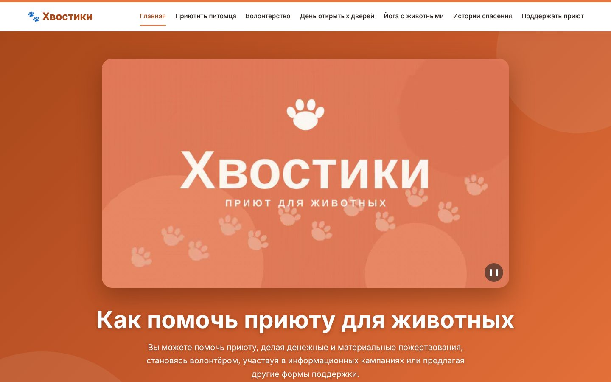
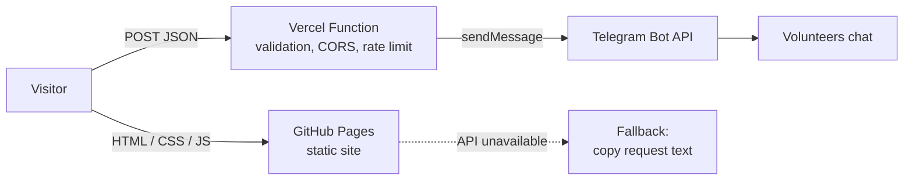

<div align="center">

# 🐾 Khvostiki — animal shelter website

A multi-page, responsive website for an animal shelter with a pet filter, a photo viewer
and a **serverless backend** (Vercel Function, Node.js) that delivers adoption requests to volunteers via Telegram.

[](https://github.com/SimaKogan/khvostiki-portfolio/actions/workflows/ci.yml)
[](https://github.com/SimaKogan/khvostiki-portfolio/actions/workflows/pages.yml)
[](LICENSE)

**[🌐 Live demo](https://SimaKogan.github.io/khvostiki-portfolio/)** · [Русская версия](README.md)



</div>

> **Demo project.** Contacts, payment details and testimonials are fictional.
> Photos are used with the owner's permission and are not covered by the MIT license. The site content is in Russian.

## Highlights

- **7 pages + custom 404**, fully responsive (320 px and up), mobile navigation with keyboard support.
- **Adoption form with a real backend**: a Vercel Function validates the request (CORS allow-list, honeypot, rate limiting, payload limits) and forwards it to a Telegram chat. If the API is unreachable, the form degrades gracefully and lets the user copy the request text, so no data is lost.
- **Pet filter**, **fullscreen photo viewer** (arrow keys, `Esc`, click-to-zoom, focus restore), one-click copy of donation details.
- **Accessibility**: semantic landmarks, skip link, ARIA, visible focus, animation pause button, `prefers-reduced-motion`.
- **SEO**: per-page title/description, Open Graph, canonical URLs, sitemap, robots.txt, web manifest.
- **No frameworks, no build step**: vanilla HTML/CSS/JS on the front end.

## Architecture



The backend runs on the free tiers of Vercel (Hobby, no credit card) and GitHub Pages: no servers, no database. The Hobby plan is for personal, non-commercial use. Design rationale: [docs/DECISIONS.md](docs/DECISIONS.md) (in Russian).

## Tech stack

HTML5 · CSS3 (custom properties, grid, flexbox) · vanilla JavaScript · Vercel Functions (Node.js, zero dependencies) · Telegram Bot API ·
`html-validate` · `node:test` · Lychee · Lighthouse · GitHub Actions (CI, Pages deploy) · Dependabot.

## Quality

| Lighthouse (mobile profile, local run) | Performance | Accessibility | Best Practices | SEO |
|---|:---:|:---:|:---:|:---:|
| All pages | 96–100 | 100 | 100 | 100 |

- The 2.2 MB hero GIF (loaded on every page) was replaced by a ~220 KB WebM/MP4 video with a poster and a pause button.
- 34 automated tests cover validation and the request handler (CORS, rate limiting, honeypot, upstream failures, secret non-disclosure, the Vercel adapter).
- CI validates HTML, checks internal links/anchors, runs the tests and on every push and pull request.

## Run locally

Requires [Node.js 20+](https://nodejs.org). One command starts both the site and the API:

```bash
git clone https://github.com/SimaKogan/khvostiki-portfolio.git
cd khvostiki-portfolio
npm run setup      # once: install dependencies
npm run dev        # site http://localhost:8080 + API http://localhost:8787
npm run check      # HTML validation + API tests
```

Put a real bot token and chat id into `server/.env.local` (created on first run) to receive requests in Telegram. Backend details: [server/README.md](server/README.md).

## License

Source code: [MIT](LICENSE). Images and photos are excluded from the license.
