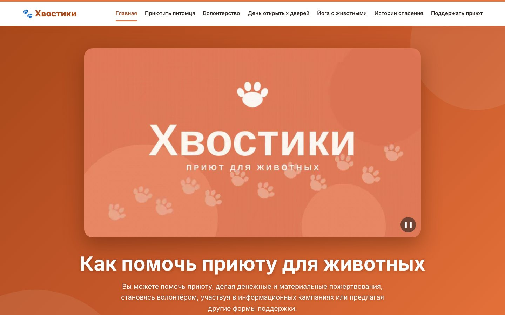
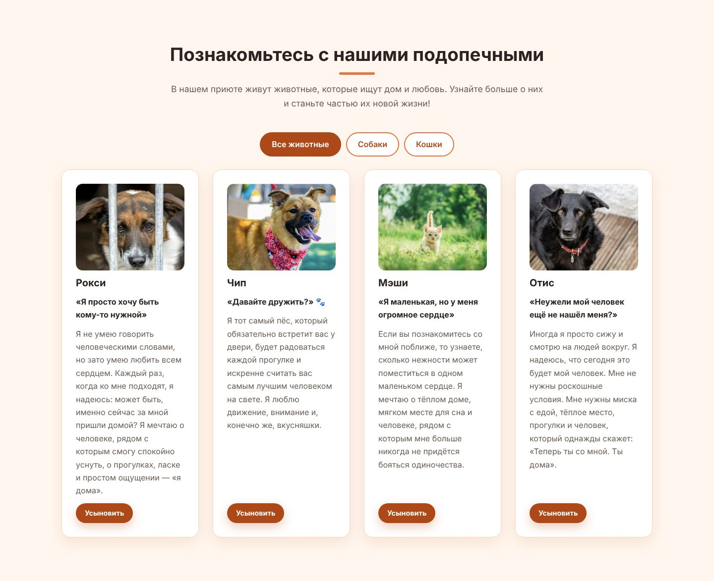
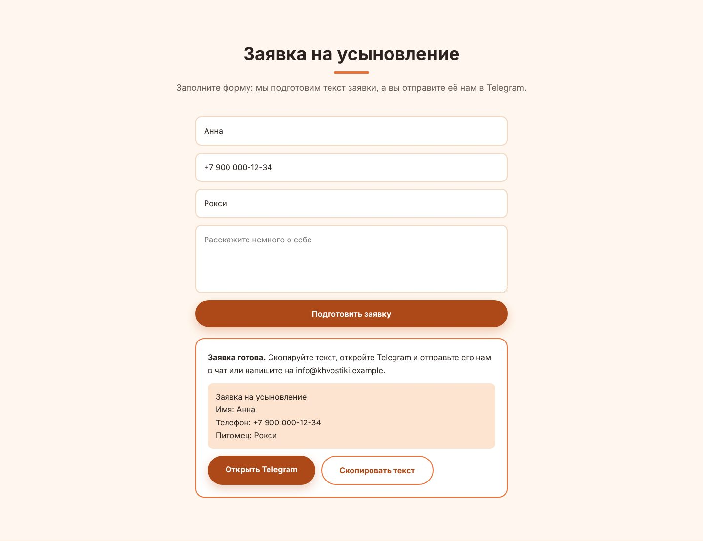
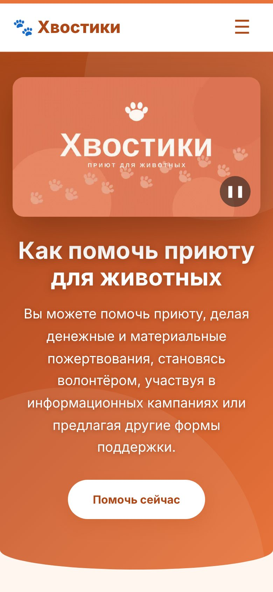
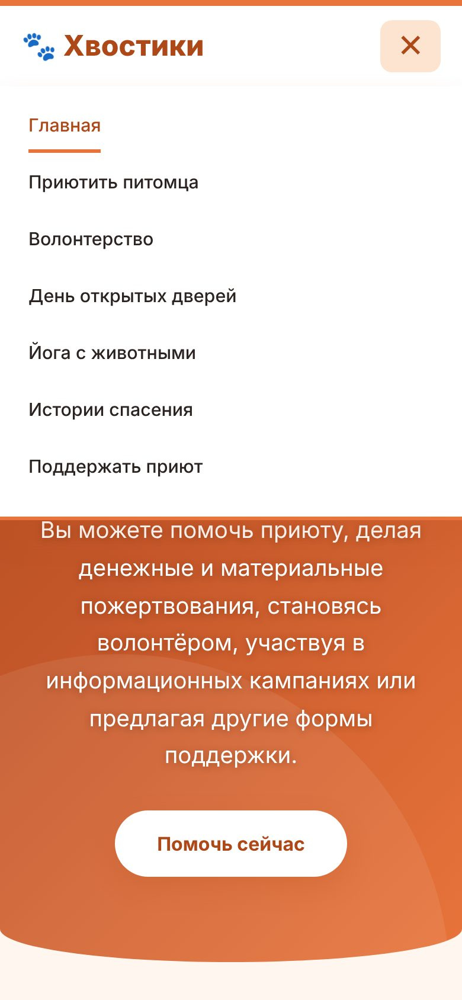
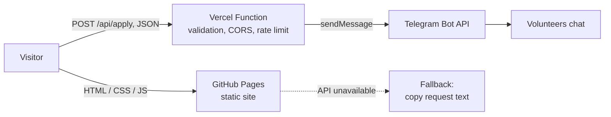

<div align="center">

# 🐾 Khvostiki — animal shelter website

A multi-page, responsive website for an animal shelter with a pet filter, a photo viewer
and a **serverless backend** that delivers adoption requests to volunteers via Telegram.

[](https://github.com/SimaKogan/khvostiki-portfolio/actions/workflows/ci.yml)
[](https://github.com/SimaKogan/khvostiki-portfolio/actions/workflows/pages.yml)


[](LICENSE)

**[🌐 Live demo](https://SimaKogan.github.io/khvostiki-portfolio/)** · [Русская версия](README.ru.md)



</div>

> **Demo project.** Contacts, payment details and testimonials are fictional.
> Photos are used with the owner's permission and are not covered by the MIT license.
> The website content is in Russian.

## Features

- **7 pages + custom 404**: home, adoption, volunteering, open day, yoga with animals, rescue stories, donations.
- **Pet filter** (dogs / cats) without a page reload; filter buttons are generated from `data-*` attributes on the cards.
- **Fullscreen photo viewer**: arrow keys, `Esc`, click-to-zoom, captions taken from the cards, focus restore.
- **Adoption form with a real backend**: the request goes to a Vercel Function and arrives in the volunteers' Telegram chat. If the API is unreachable, the form degrades gracefully and lets the user copy the request text, so nothing is lost.
- **One-click copy** of donation details, QR code for transfers.
- **Responsive** from 320 px up, mobile navigation, `safe-area` support on iPhone.
- **Accessibility**: semantic landmarks (`<main>`, `<nav>`), skip link, `aria-*`, visible focus, keyboard navigation, animation pause button, `prefers-reduced-motion`.
- **SEO**: unique `title`/`description` per page, Open Graph, `canonical`, `sitemap.xml`, `robots.txt`, web manifest.
- **No frameworks, no build step** on the front end.

## Screenshots

| Pets and filter | Adoption form | Mobile |
|---|---|---|
|  |  |   |

## Architecture



The site is static, and the **backend exists in exactly one place**: the adoption form. It is a Vercel Function on Node.js with the free Hobby plan (no credit card), no server, no database and no dependencies. The core logic uses standard `Request`/`Response`, so it is not tied to the platform. Design rationale: [docs/DECISIONS.md](docs/DECISIONS.md) (in Russian).

## Tech stack

| Layer | Technologies |
|---|---|
| Front end | HTML5, CSS3 (custom properties, grid, flexbox, `clamp()`), vanilla JavaScript, no dependencies, no build step |
| Back end | Vercel Functions (Node.js 22, ES modules, zero dependencies), Telegram Bot API |
| Quality | `html-validate`, `node:test`, Lychee (link check), Lighthouse |
| CI/CD | GitHub Actions: checks on every push/PR, automatic deploy to GitHub Pages; API deployed by the Vercel–GitHub integration |

## Repository structure

```text
.
├── site/                 # static site (published to GitHub Pages)
│   ├── *.html            # pages
│   ├── style.css         # shared styles
│   ├── site.js           # menu, filter, lightbox, form
│   ├── img/, photos/     # images, hero video (webm/mp4)
│   └── 404.html, robots.txt, sitemap.xml, site.webmanifest
├── server/               # serverless adoption API (Vercel Function)
│   ├── api/apply.js      # Vercel entry point
│   ├── lib/              # handle.js (core), validate.js, rate-limit.js
│   └── test/             # 34 automated tests
├── scripts/dev.mjs       # run the site and the API locally with one command
├── docs/                 # screenshots, social preview, design decisions
└── .github/              # CI, deploy, Dependabot
```

## Run locally

Requires [Node.js 20+](https://nodejs.org). One command starts both the site and the API:

```bash
git clone https://github.com/SimaKogan/khvostiki-portfolio.git
cd khvostiki-portfolio
npm run setup        # once: install dependencies
npm run dev          # site http://localhost:8080 + API http://localhost:8787/api/apply
```

On the local page the form is wired to the local API automatically. To receive requests in Telegram, put a real bot token and chat id into `server/.env.local` (created on first run). While it contains placeholders, the form shows the fallback with a text to copy.

```bash
npm run check        # HTML validation + API tests (34 tests)
```

API details: [server/README.md](server/README.md) (in Russian).

## Deployment

1. **Site.** `Settings → Pages → Source: GitHub Actions`. Every push to `main` publishes the `site/` folder (workflow `pages.yml`). The site URL in meta tags, `sitemap.xml` and `robots.txt` is substituted automatically.
2. **API (optional).** Import the repository into Vercel with **Root Directory** `server`, add `TELEGRAM_BOT_TOKEN`, `TELEGRAM_CHAT_ID` and `ALLOWED_ORIGINS` as environment variables, then save the function URL (`https://<project>.vercel.app/api/apply`) as the repository variable `API_URL`. The form on the site starts sending requests to the server. Step by step: [server/README.md](server/README.md).

## Quality

Local Lighthouse run (mobile profile) across the site pages:

| Performance | Accessibility | Best Practices | SEO |
|:---:|:---:|:---:|:---:|
| 96–100 | 100 | 100 | 100 |

What was done to get there:

- the heavy hero GIF (**2.2 MB** on every page) was replaced by WebM/MP4 video (**≈220 KB** as WebM, about 10× smaller) with a poster and a pause button;
- obsolete markup (`<nobr>`, `align`, `border`, `cellpadding`) was replaced by semantic HTML and CSS, inline styles were removed;
- the mobile menu works from the keyboard (a `<button>` with `aria-expanded` instead of a hidden checkbox);
- contrast of buttons and links was raised to WCAG AA (from 3:1 to ≥ 5:1);
- the heading structure was fixed (`h1 → h2 → h3`);
- 34 automated tests cover validation, the request handler (CORS, rate limiting, honeypot, upstream failures, secret non-disclosure) and the Vercel adapter;
- CI validates HTML, checks internal links and anchors, and runs the tests on every push and pull request.

## License

Source code: [MIT](LICENSE). Images and photos are excluded from the license.
