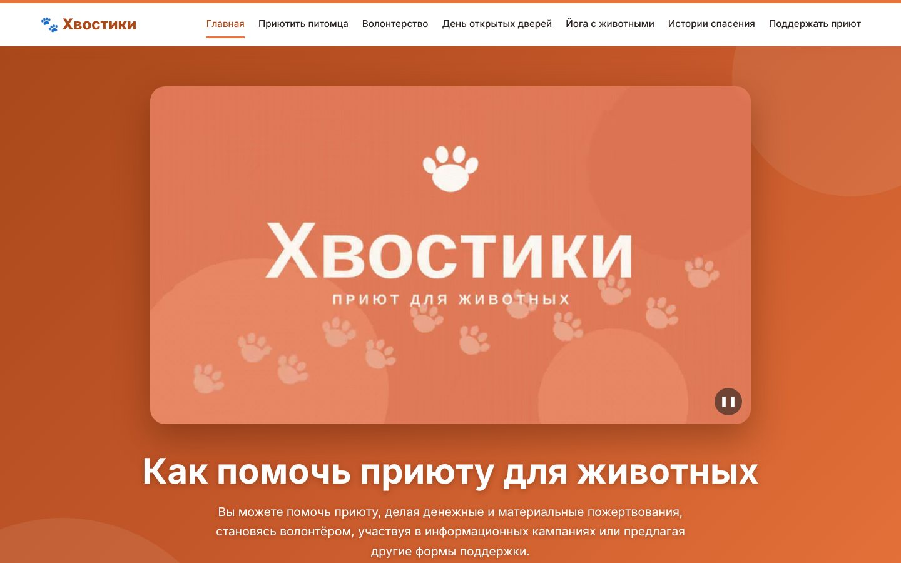
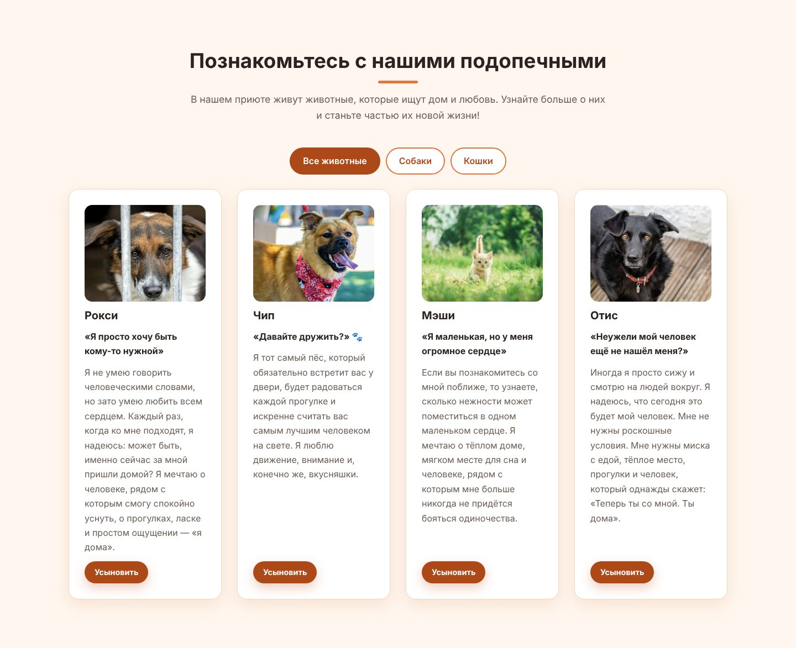
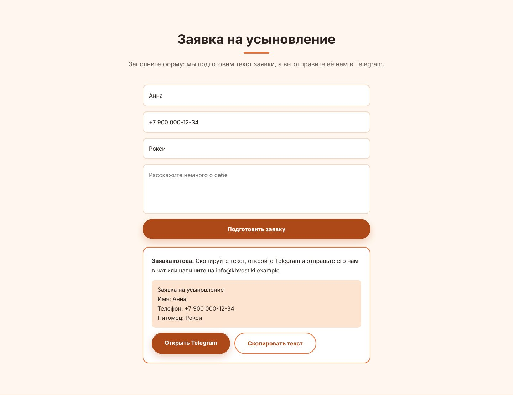
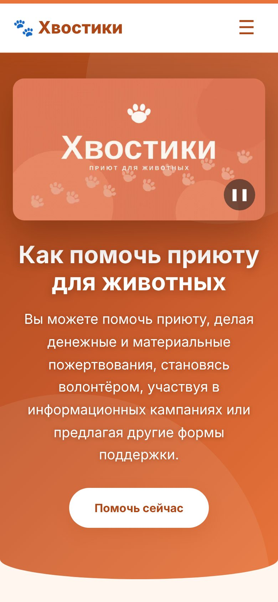
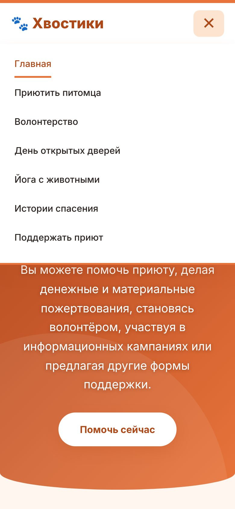
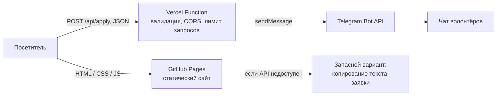

<div align="center">

# 🐾 Хвостики — сайт приюта для животных

Многостраничный сайт приюта с адаптивной вёрсткой, фильтром питомцев, фотопросмотром
и **serverless-бэкендом**, который доставляет заявки на усыновление волонтёрам в Telegram.

[](https://github.com/SimaKogan/khvostiki-portfolio/actions/workflows/ci.yml)
[](https://github.com/SimaKogan/khvostiki-portfolio/actions/workflows/pages.yml)


[](LICENSE)

**[🌐 Открыть демо](https://SimaKogan.github.io/khvostiki-portfolio/)** · [English version](README.md)



</div>

> **Демонстрационный проект.** Контакты, реквизиты и отзывы на сайте выдуманные.
> Фотографии используются с разрешения правообладателя и не покрываются лицензией MIT.

## Возможности

- **7 страниц**: главная, усыновление, волонтёрство, день открытых дверей, йога с животными, истории спасения, поддержка приюта + страница 404.
- **Фильтр питомцев** (собаки/кошки) без перезагрузки страницы, кнопки строятся из `data-*` атрибутов карточек.
- **Фотопросмотр** на весь экран: стрелки, `Esc`, приближение кликом, подписи из карточек, возврат фокуса.
- **Форма заявки на усыновление с реальным бэкендом**: данные уходят во Vercel Function и приходят волонтёрам в Telegram. Если сервер недоступен, форма не теряет данные и предлагает скопировать текст заявки.
- **Копирование реквизитов** одним кликом, QR-код для перевода.
- **Адаптивность** от 320 px до широких экранов, мобильное меню, поддержка `safe-area` на iPhone.
- **Доступность**: семантические ориентиры (`<main>`, `<nav>`), skip-ссылка, `aria-*`, фокус-стили, клавиатурная навигация, пауза анимации, `prefers-reduced-motion`.
- **SEO**: уникальные `title`/`description`, Open Graph, `canonical`, `sitemap.xml`, `robots.txt`, web manifest.

## Скриншоты

| Питомцы и фильтр | Форма заявки | Мобильная версия |
|---|---|---|
|  |  |   |

## Архитектура



Сайт статический, а **бэкенд нужен ровно в одном месте**: форма заявки. Для него выбрана Vercel Function на Node.js: бесплатный тариф Hobby (без карты), нет сервера и базы данных, ядро без зависимостей. Подробнее о решениях: [docs/DECISIONS.md](docs/DECISIONS.md).

## Технологии

| Слой | Что используется |
|---|---|
| Фронтенд | HTML5, CSS3 (custom properties, grid, flex, `clamp()`), ванильный JavaScript без зависимостей и сборки |
| Бэкенд | Vercel Functions (Node.js 22, ES modules, без зависимостей), Telegram Bot API |
| Качество | `html-validate`, `node:test`, Lychee (проверка ссылок), Lighthouse |
| CI/CD | GitHub Actions: проверки на каждый push/PR, автодеплой на GitHub Pages, деплой API через интеграцию Vercel с GitHub |

## Структура репозитория

```text
.
├── site/                 # статический сайт (публикуется на GitHub Pages)
│   ├── *.html            # страницы
│   ├── style.css         # общие стили
│   ├── site.js           # меню, фильтр, лайтбокс, форма
│   ├── img/, photos/     # изображения, hero-видео (webm/mp4)
│   └── 404.html, robots.txt, sitemap.xml, site.webmanifest
├── server/               # serverless API заявок (Vercel Function)
│   ├── api/apply.js      # точка входа Vercel
│   ├── lib/              # handle.js (ядро), validate.js, rate-limit.js
│   └── test/             # 34 автотеста
├── scripts/dev.mjs       # локальный запуск сайта и API одной командой
├── docs/                 # скриншоты и описание архитектурных решений
└── .github/              # CI, деплой, Dependabot
```

## Запуск локально

Нужен только [Node.js 20+](https://nodejs.org). Одна команда поднимает и сайт, и API:

```bash
git clone https://github.com/SimaKogan/khvostiki-portfolio.git
cd khvostiki-portfolio
npm run setup        # один раз: установка зависимостей
npm run dev          # сайт http://localhost:8080 + API http://localhost:8787
```

Форма на локальной странице автоматически направлена на локальный API. Чтобы заявки реально приходили в Telegram, впишите токен бота и chat id в `server/.env.local` (файл создаётся при первом запуске). Пока там заглушки, форма покажет запасной вариант с текстом для копирования.

```bash
npm run check        # проверка HTML + тесты API (34 теста)
```

Подробнее про API: [server/README.md](server/README.md).

## Деплой

1. **Сайт.** `Settings → Pages → Source: GitHub Actions`. Дальше каждый push в `main` публикует папку `site/` (workflow `pages.yml`); адрес сайта в мета-тегах, `sitemap.xml` и `robots.txt` подставляется автоматически.
2. **API (по желанию).** Разворачивается за 5 минут по [инструкции](server/README.md) (импорт репозитория в Vercel, Root Directory `server`); адрес функции записывается в переменную репозитория `API_URL`, и форма на сайте начинает отправлять заявки на сервер.

## Качество

Локальный прогон Lighthouse (мобильный профиль) по страницам сайта:

| Performance | Accessibility | Best Practices | SEO |
|:---:|:---:|:---:|:---:|
| 96–100 | 100 | 100 | 100 |

Что сделано для этого:

- тяжёлый hero-GIF (**2,2 МБ** на каждой странице) заменён на видео WebM/MP4 (**≈220 КБ** в WebM, около 10 раз меньше) с постером и кнопкой паузы;
- устаревшая разметка (`<nobr>`, `align`, `border`, `cellpadding`) заменена семантическим HTML и CSS, инлайн-стили убраны;
- меню на мобильных работает с клавиатуры (`<button>` с `aria-expanded` вместо скрытого чекбокса);
- контраст кнопок и ссылок доведён до WCAG AA (был 3:1, стал ≥ 5:1);
- структура заголовков исправлена (`h1 → h2 → h3`).

## Лицензия

Исходный код распространяется по лицензии [MIT](LICENSE). Фотографии и изображения не входят в лицензию.
